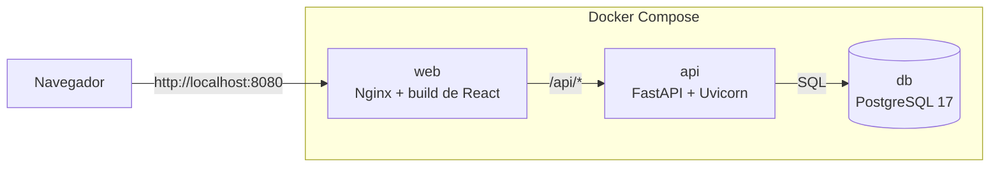
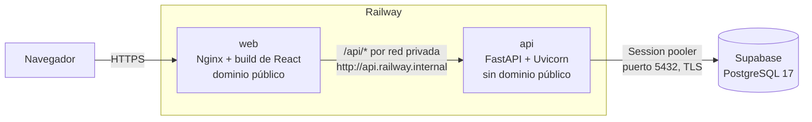

# Sistema de Control de Proyectos y Recursos FaCyT

Aplicación web cliente-servidor para controlar los proyectos de física, química y biología de una organización académica y empresarial: su avance, su presupuesto, la materia prima, los equipos, los consumibles compartidos y el flujo de aprobación de gastos.

Proyecto final de la asignatura **Desarrollo de Aplicaciones Web**, Escuela de Computación, Universidad de Carabobo.

> **Estado del proyecto:** en desarrollo. Este README define el stack aprobado, la estructura del repositorio y los pasos de instalación que el código debe cumplir. Cada comando se valida a medida que se construye el módulo correspondiente.

## Tabla de contenido

1. [Descripción del proyecto](#1-descripción-del-proyecto)
2. [Objetivo](#2-objetivo)
3. [Roles](#3-roles)
4. [Módulos](#4-módulos)
5. [Resumen de requisitos](#5-resumen-de-requisitos)
6. [Stack tecnológico](#6-stack-tecnológico)
7. [Arquitectura](#7-arquitectura)
8. [Estructura del proyecto](#8-estructura-del-proyecto)
9. [Requisitos previos](#9-requisitos-previos)
10. [Instalación y ejecución con Docker (recomendada)](#10-instalación-y-ejecución-con-docker-recomendada)
11. [Configuración](#11-configuración)
12. [Instalación manual para desarrollo](#12-instalación-manual-para-desarrollo)
13. [Base de datos y datos semilla](#13-base-de-datos-y-datos-semilla)
14. [Pruebas](#14-pruebas)
15. [Despliegue en la nube: Supabase y Railway](#15-despliegue-en-la-nube-supabase-y-railway)
16. [Alcance](#16-alcance)
17. [Limitaciones](#17-limitaciones)
18. [Solución de problemas](#18-solución-de-problemas)
19. [Uso de inteligencia artificial y prompts](#19-uso-de-inteligencia-artificial-y-prompts)
20. [Documentación del proyecto](#20-documentación-del-proyecto)
21. [Equipo y licencia](#21-equipo-y-licencia)

---

## 1. Descripción del proyecto

La organización lleva hoy en hojas de cálculo el seguimiento de varios proyectos simultáneos. Con ese método no controla bien la materia prima, el uso de los equipos ni los consumibles, y no puede repartir entre los proyectos el costo de los consumibles compartidos (*overhead*), como guantes de nitrilo, papel absorbente o solventes multipropósito, que se compran por lotes institucionales.

El sistema reemplaza las hojas de cálculo con una sola plataforma que:

- registra los proyectos con su código, estatus, prioridad, hitos, avance físico y ejecución presupuestaria;
- controla el inventario por lotes, con stock actualizado en cada movimiento, alertas de stock mínimo y de vencimiento, y reposición automática;
- administra los equipos, su estado operacional y sus reservas sin choques de horario;
- aplica un flujo de aprobación a toda solicitud de gasto o de retiro de insumos;
- reparte el costo de los consumibles compartidos al cerrar cada período contable;
- deja trazabilidad completa en una bitácora de despachos y un registro de auditoría que nadie puede editar ni borrar.

## 2. Objetivo

**Objetivo general.** Desarrollar un sistema web cliente-servidor que centralice el control, el estatus y la información de los proyectos y de sus recursos, y que supere las limitaciones del manejo en hojas de cálculo.

**Objetivos específicos.**

1. Registrar los proyectos con sus atributos obligatorios y calcular su avance físico y su ejecución presupuestaria.
2. Controlar en tiempo real el stock de materia prima y consumibles, por lote y con su vencimiento.
3. Prevenir conflictos de agendamiento de los equipos entre proyectos.
4. Someter toda adquisición o asignación de recursos al flujo Borrador, Pendiente de Aprobación, Aprobado o Rechazado, y Ejecutado.
5. Prorratear el costo de los consumibles compartidos entre los proyectos activos, en proporción al consumo o en partes iguales.
6. Ofrecer un dashboard ejecutivo, reportes en PDF y Excel, y un registro de auditoría inmutable.

## 3. Roles

| Rol | Alcance | Responsabilidad principal |
|---|---|---|
| Administrador del Sistema | Todo el sistema | Gestiona usuarios, parámetros generales y catálogos (ubicaciones, consumibles, equipos). Registra los proyectos y les asigna coordinador. Consulta el dashboard y la auditoría global |
| Coordinador de Proyecto | Sus proyectos asignados | Carga hitos y avances, registra el uso de materia prima y equipos, y crea solicitudes de gasto o de retiro de insumos |
| Aprobador / Gestor de Inventario | Inventario y finanzas | Aprueba o rechaza solicitudes y reservas, recibe y despacha lotes, ajusta prioridades, cierra el período contable y ejecuta el prorrateo |

Los beneficiarios y el personal general de los laboratorios **no tienen usuario** en el sistema (RN-01).

## 4. Módulos

| # | Módulo | Qué hace | Funcionalidades |
|---|---|---|---|
| 1 | Usuarios, catálogos y parámetros | Cuentas de los tres roles, ubicaciones de almacenamiento y parámetros generales | F1.1 a F1.5 |
| 2 | Proyectos y avance | Registro del proyecto, asignación de coordinador, estatus, hitos ponderados, avance físico y ejecución presupuestaria | F2.1 a F2.7 |
| 3 | Inventario de materia prima y consumibles | Catálogo unificado, stock mínimo, stock en tiempo real, alertas, reposición automática, vencimiento de lotes y pronóstico de consumo | F3.1 a F3.7 |
| 4 | Equipos y reservas | Catálogo de activos, estado operacional, reservas sin choques con aprobación y registro de uso | F4.1 a F4.6 |
| 5 | Solicitudes y priorización | Solicitudes de gasto y de retiro con su flujo de estados, y orden de los proyectos por prioridad con justificación obligatoria | F5.1 a F5.7 |
| 6 | Almacén | Recepción de lotes, despacho con lote sugerido por vencimiento, bitácora inalterable, uso de materia prima y corrección de despachos | F6.1 a F6.6 |
| 7 | Cierre de período y prorrateo | Confirmación de cargos por los coordinadores, cierre del período y prorrateo con vista previa | F7.1 a F7.4 |
| 8 | Reportes y auditoría | Dashboard ejecutivo, exportación a PDF y Excel, y `audit_log` | F8.1 a F8.6 |

El detalle de cada funcionalidad, sus historias de usuario y sus diagramas de flujo está en el [documento de requisitos](docs/requisitos/2026-10-25_ControlProyectos_DocRequerimientos_v0.1.md) y en [flujos_trazabilidad.md](docs/diagramas/flujos/flujos_trazabilidad.md).

## 5. Resumen de requisitos

Los códigos de trabajo vienen de [requisitos_base.md](docs/requisitos/requisitos_base.md). Las decisiones D1 a D13 que los precisan están registradas en ese mismo archivo.

### Requisitos funcionales

| Área | Requisitos | Resumen |
|---|---|---|
| Roles y catálogos | RF-01 a RF-10 | Funciones de cada rol según la matriz del enunciado |
| Estructura de proyectos | RF-11 a RF-16 | Código único alfanumérico, estatus (Propuesta, En ejecución, Suspendido, Finalizado), prioridad (Crítica, Alta, Media, Baja), avance físico por hitos ponderados y ejecución presupuestaria sobre el presupuesto asignado |
| Inventario y equipos | RF-17 a RF-23 | Catálogo unificado, stock en tiempo real, alertas de stock mínimo configurable, lotes con fecha de ingreso, costo unitario y proveedor, equipos con estado operacional, reservas sin conflictos y bitácora inalterable de despachos |
| Prorrateo | RF-24 a RF-27 | Cierre de período mensual o trimestral y reparto del overhead proporcional al consumo o en partes iguales entre los proyectos activos |
| Solicitudes y priorización | RF-28, RF-29 | Orden dinámico por prioridad y flujo de estados obligatorio para toda adquisición o asignación de recursos |
| Reportes y auditoría | RF-30 a RF-34 | Dashboard con KPIs, reportes PDF y Excel de gastos, prorrateo y hoja de vida de equipos, y `audit_log` con `timestamp`, `user_id` e `ip_address` |

### Propuestas aprobadas

Salen del [benchmarking](docs/benchmarking/benchmarking.md) y se aprobaron el 25/10/2026 ([propuestas.md](docs/propuestas/propuestas.md)).

| Código | Propuesta | Origen |
|---|---|---|
| RF-35 | Corrección de un despacho o cargo mediante una solicitud aprobada, sin modificar el registro original | NEMO, Chimote et al. 2022 |
| RF-36 | Fecha de vencimiento por lote, alerta de lotes próximos a vencer y bloqueo de lotes vencidos | ERPNext |
| RF-37 | Solicitud de reposición en Borrador cuando un insumo baja de su mínimo | ERPNext, NEMO |
| RF-38 | Confirmación de cargos por el coordinador antes del cierre del período | Chimote et al. 2022 |
| IA-01 | Pronóstico del consumo de cada insumo para el próximo período | Regulski et al. 2024, Opaliński et al. 2026 |

### Reglas de negocio

| Código | Regla |
|---|---|
| RN-01 | Los beneficiarios y el personal general de los laboratorios no tienen usuario |
| RN-02 | Los consumibles de uso general no se asignan a un proyecto al comprarlos; su costo se reparte al cerrar el período |
| RN-03 | Flujo de solicitudes: Borrador, Pendiente de Aprobación, Aprobado o Rechazado, y Ejecutado. Solo "Aprobado" pasa a "Ejecutado". "Rechazado" es final |
| RN-04 | Todo cambio de prioridad exige una justificación escrita que queda en el `audit_log` |
| RN-05 | Un proyecto es activo solo si su estatus es "En ejecución" |
| RN-06 | La bitácora de despachos y el `audit_log` no se editan ni se borran; un error se corrige con un registro nuevo |
| RN-07 | El Coordinador solo ve y opera sobre sus proyectos asignados |

### Requisitos no funcionales

| Código | Requisito | Dónde se cumple |
|---|---|---|
| RNF-01 | Arquitectura cliente-servidor, modular y mantenible | [Arquitectura](#7-arquitectura) |
| RNF-02 | Pila libre con base de datos relacional | PostgreSQL 17 |
| RNF-03 | Interfaz moderna, limpia y responsive, estilo Apple, con modo claro y oscuro | Tailwind CSS y shadcn/ui |
| RNF-04 | Empaquetada para desplegarse en un servidor local o en la nube, simulando producción | Docker Compose, Supabase y Railway |
| RNF-05 | Repositorio con separación clara entre frontend y backend | `frontend/` y `backend/` |
| RNF-06 | Scripts SQL de estructura y datos semilla con usuarios de prueba por rol | [`database/`](#13-base-de-datos-y-datos-semilla) |
| RNF-07 | README exhaustivo con instalación, configuración, ejecución, alcance y limitaciones | Este archivo |
| RNF-08 | El equipo defiende la lógica del código y las decisiones de arquitectura | [Stack tecnológico](#6-stack-tecnológico) |
| RNF-09 | Archivo con los prompts principales usados en el desarrollo | [`prompts/PROMPTS.md`](#19-uso-de-inteligencia-artificial-y-prompts) |
| RNF-10 | El stock se actualiza en la misma operación que registra cada movimiento | Transacciones en PostgreSQL |
| RNF-11 | Nadie, ni el Administrador, puede editar o borrar la bitácora de despachos | Triggers en `02_constraints_triggers.sql` |
| RNF-12 | Nadie, ni el Administrador, puede editar o borrar el `audit_log` | Triggers en `02_constraints_triggers.sql` |

## 6. Stack tecnológico

Las versiones se verificaron el 27/10/2026 en endoflife.date, PyPI y npm.

### Frontend

| Pieza | Elección | Por qué | Requisitos |
|---|---|---|---|
| Framework | React 19 + TypeScript + Vite 8 + React Router | El ecosistema más amplio para las piezas que necesitamos (calendario, gráficos, formularios, componentes accesibles). Se compila a archivos estáticos que sirve Nginx | RNF-01, RNF-05 |
| Estilo | Tailwind CSS 4 + shadcn/ui (sobre Radix UI) | Los tokens de color neutros, el radio de los bordes y el espaciado se definen en un solo lugar. El modo oscuro usa variables CSS con `prefers-color-scheme` y un selector manual. La fuente es la del sistema (`-apple-system, system-ui`), que muestra San Francisco en equipos Apple sin problemas de licencia. Radix da diálogos y menús accesibles | RNF-03 |
| Datos del servidor | TanStack Query | Vuelve a pedir el stock después de cada recepción o despacho, así la pantalla muestra la cantidad nueva enseguida | RNF-10 |
| Formularios | React Hook Form + Zod | Validación junto a cada campo, con el mensaje que explica cómo corregir | L4 de la investigación UX |
| Calendario | FullCalendar (núcleo con licencia MIT) | Es el que usa eLabFTW para sus reservas. Muestra lo ocupado y los equipos en mantenimiento antes de pedir | RF-22 |
| Gráficos | Recharts | KPIs y tendencias del dashboard | RF-30 |

### Backend

| Pieza | Elección | Por qué | Requisitos |
|---|---|---|---|
| Lenguaje y framework | Python 3.14 + FastAPI + Pydantic v2 | API REST tipada, con validación de entrada y documentación OpenAPI automática en `/api/docs`. Python permite hacer el pronóstico de IA-01 dentro del mismo backend | RNF-01, RNF-08 |
| Servidor | Uvicorn, detrás de Nginx | Servidor ASGI de producción. Con `--proxy-headers` toma la IP real del cliente para el `audit_log` | RNF-04, RF-34 |
| Acceso a datos | SQLAlchemy 2.1 + psycopg 3 | Mapea las tablas que crean los scripts SQL. Las operaciones de stock usan transacciones y `SELECT ... FOR UPDATE`, así ningún movimiento deja el stock a medias | RNF-06, RNF-10 |
| Autenticación | Sesiones en el servidor | Ver [Autenticación](#autenticación) | RF-01, RN-07 |
| Contraseñas | Argon2id con `pwdlib[argon2]` | Algoritmo preferido por OWASP y librería que usa la documentación de FastAPI | RF-01 |
| Reportes | WeasyPrint (PDF desde plantillas HTML) y openpyxl (Excel) | Los PDF reusan el estilo de la interfaz. NEMO genera su Excel con drf-excel, que se apoya en openpyxl | RF-31 a RF-33 |
| Pronóstico (IA-01) | statsmodels: suavizado exponencial Holt-Winters, con ARIMA como alternativa | Son los modelos clásicos que usan Opaliński et al. (2026) y alcanzan para un volumen de datos académico. Se calcula a pedido desde la bitácora de despachos. No es IA generativa: no necesita claves de API ni servicios externos | IA-01 |
| Tareas en segundo plano | Ninguna | Los vencimientos se calculan al consultar, la reposición de RF-37 nace en la misma transacción del despacho y los avisos son una bandeja dentro de la aplicación. No hacen falta colas como Celery o Redis | RF-36, RF-37 |

### Base de datos

| Pieza | Elección | Por qué | Requisitos |
|---|---|---|---|
| Motor | PostgreSQL 17 | Relacional. Es la versión mayor de Supabase (17.11), y el entorno local usa la misma para que los scripts corran igual en los dos lados | RNF-02 |
| Reservas sin choques | Extensión `btree_gist` + restricción `EXCLUDE USING GIST` | La propia base rechaza dos reservas del mismo equipo que se superponen, aunque lleguen al mismo tiempo. Es el ejemplo de la documentación oficial de PostgreSQL, y Supabase incluye la extensión | RF-22, F4.4 |
| Inmutabilidad | Triggers `BEFORE UPDATE OR DELETE` que lanzan un error | Bloquean cualquier edición o borrado de la bitácora y del `audit_log` que venga de la aplicación, sin importar el rol del usuario | RNF-11, RNF-12 |
| Fuente de verdad | Scripts SQL escritos a mano | El esquema, las restricciones y el seed están en `database/`. El backend los mapea y no los genera. Una prueba compara los modelos con el esquema para que no se desfasen | RNF-06 |

### Autenticación

Se siguen el *OWASP Session Management Cheat Sheet* y el patrón *Backend for Frontend* del RFC 10017 de la IETF. El navegador nunca recibe un token que pueda leer JavaScript.

| Aspecto | Decisión |
|---|---|
| Identificador de sesión | 256 bits aleatorios (`secrets.token_urlsafe(32)`). En la tabla `sesion` se guarda su hash SHA-256, nunca el valor |
| Cookie | `__Host-sesion` con `HttpOnly`, `Secure`, `SameSite=Strict`, `Path=/` y sin `Domain` |
| Tiempos | Cierre tras 30 minutos sin actividad y a las 8 horas en cualquier caso, configurables por variables de entorno |
| Invalidación | Al iniciar sesión se crea un identificador nuevo. Cerrar sesión la borra en el servidor. Cambiar el rol de una cuenta (F1.2) o desactivarla (F1.3) borra todas sus sesiones |
| CSRF | *Synchronizer token* guardado en la sesión y enviado en el encabezado `X-CSRF-Token` en cada POST, PUT, PATCH y DELETE. Además se verifica `Sec-Fetch-Site` u `Origin`. SameSite queda como defensa extra |
| Autorización | El rol y el alcance (RN-07) se validan en el backend en cada petición; el frontend solo oculta lo que no corresponde |
| Auditoría | El inicio y el cierre de sesión quedan en el `audit_log` con su IP |

### Infraestructura y calidad

| Pieza | Elección | Por qué | Requisitos |
|---|---|---|---|
| Empaquetado | Docker y Docker Compose | El evaluador levanta todo con un comando. NEMO, eLabFTW y ERPNext se instalan de la misma forma | RNF-04, RNF-07 |
| Proxy web | Nginx | Sirve el build de React y reenvía `/api` al backend. El navegador ve un solo origen, así que no hace falta CORS y las cookies funcionan sin excepciones | RNF-01, RNF-04 |
| Base de datos en la nube | Supabase (solo PostgreSQL) | PostgreSQL administrado, en la misma versión mayor que el entorno local | RNF-04 |
| Hosting del frontend y el backend | Railway | Despliega cada carpeta del monorepo desde su Dockerfile, con red privada entre servicios y HTTPS automático | RNF-04 |
| Pruebas | pytest con el `TestClient` de FastAPI; Vitest; Playwright opcional | RNF-11 y RNF-12 se verifican "por prueba". También se prueban RN-03, el prorrateo y los choques de reservas | RNF-11, RNF-12 |
| Estilo de código | Ruff (Python); ESLint y Prettier (TypeScript) | Formato uniforme y detección temprana de errores | RNF-01 |

### Por qué este stack y no otro

Se compararon los stacks de los proyectos del [benchmarking](docs/benchmarking/benchmarking.md):

| Proyecto | Stack |
|---|---|
| NEMO (NIST) | Python con Django 5.2, Django REST Framework y django-auditlog; SQLite por defecto y PostgreSQL para organizaciones grandes; Nginx; Docker |
| eLabFTW | PHP 8.4 con componentes Symfony y Twig; MySQL; TypeScript, Bootstrap y FullCalendar; Docker |
| ERPNext | Python con Frappe Framework; Vue; MariaDB; Redis |

Se eligió Python porque es el lenguaje de los dos referentes más cercanos, NEMO y ERPNext, y porque permite hacer el pronóstico sin un servicio aparte. Entre los frameworks de Python, FastAPI fue elección del equipo. PostgreSQL se eligió sobre MySQL y MariaDB porque puede impedir las reservas superpuestas desde la propia base, con una restricción de exclusión.

## 7. Arquitectura

Arquitectura cliente-servidor en tres capas. El cliente es una SPA de React. El servidor es una API REST con FastAPI, organizada en un paquete por módulo. Los datos viven en PostgreSQL. Nginx es la única puerta de entrada.

### Entorno local (Docker Compose)



### Producción (Railway y Supabase)



**Decisiones clave:**

- **Un solo origen.** El frontend y la API se sirven desde el mismo dominio. Las cookies de sesión son de primera parte y no hace falta CORS.
- **API privada en producción.** El servicio `api` de Railway no tiene dominio público; solo lo alcanza `web` por la red privada.
- **Reglas de negocio en el backend.** El flujo de RN-03, el alcance de RN-07 y los cálculos de avance, ejecución y prorrateo viven en la capa de servicios de cada módulo, nunca en el frontend.
- **Integridad en la base.** La restricción de choques de reservas y la inmutabilidad de la bitácora y del `audit_log` se aplican en PostgreSQL, así que siguen vigentes aunque haya un error en el código.

## 8. Estructura del proyecto

La estructura sigue las convenciones de los proyectos de referencia del mismo stack:

- [full-stack-fastapi-template](https://github.com/fastapi/full-stack-fastapi-template), el template oficial de FastAPI con React, Vite, Tailwind y shadcn/ui: carpetas `backend/`, `frontend/` y `scripts/` en la raíz, y `app/core/` en el backend.
- [fastapi-best-practices](https://github.com/zhanymkanov/fastapi-best-practices): un paquete por módulo con `router.py`, `schemas.py`, `models.py`, `service.py` y `dependencies.py`, y pruebas con el mismo orden que el código.
- [bulletproof-react](https://github.com/alan2207/bulletproof-react/blob/master/docs/project-structure.md): frontend organizado por módulos. Cada módulo tiene solo las subcarpetas que usa y no importa de otro módulo; los módulos se combinan en las páginas de `app/routes/`.
- [shadcn/ui para Vite](https://ui.shadcn.com/docs/installation/vite): `components.json`, alias `@` y `src/components/ui/`.

Los paquetes `autenticacion/`, `exportacion/` y `pronostico/` del backend corresponden a las piezas Autenticación, Reportes y Pronóstico de [`arquitectura.drawio`](docs/diagramas/arquitectura/arquitectura.drawio).

```
/
├── .claude/
│   └── skills/                       Skills de Claude Code del proyecto (documento de requisitos y su formato)
│
├── backend/                          Servidor FastAPI, servicio "api"
│   ├── app/
│   │   ├── main.py                   Crea la aplicación y registra los routers
│   │   ├── core/                     Settings, conexión a la base, Argon2 y dependencias comunes
│   │   ├── autenticacion/            Inicio y cierre de sesión, tabla sesion, CSRF y verificación de rol (RN-07)
│   │   ├── auditoria/                Escritura del audit_log, que usan todos los módulos
│   │   ├── exportacion/              Generación de PDF (WeasyPrint) y de Excel (openpyxl)
│   │   │   └── plantillas/           Plantillas HTML de los PDF
│   │   ├── pronostico/               Holt-Winters y ARIMA con statsmodels sobre la bitácora (IA-01)
│   │   └── modulos/                  Un paquete por módulo: router, schemas, models, service, dependencies
│   │       ├── usuarios/             M1 Usuarios, catálogos y parámetros (F1.1 a F1.5)
│   │       ├── proyectos/            M2 Proyectos y avance (F2.1 a F2.7)
│   │       ├── inventario/           M3 Inventario de materia prima y consumibles (F3.1 a F3.7)
│   │       ├── equipos/              M4 Equipos y reservas (F4.1 a F4.6)
│   │       ├── solicitudes/          M5 Solicitudes y priorización (F5.1 a F5.7)
│   │       ├── almacen/              M6 Almacén: recepción, despacho y bitácora (F6.1 a F6.6)
│   │       ├── prorrateo/            M7 Cierre de período y prorrateo (F7.1 a F7.4)
│   │       └── reportes/             M8 Dashboard, exportación y consulta de auditoría (F8.1 a F8.6)
│   ├── tests/                        pytest, con el mismo orden que app/
│   │   ├── base_datos/               Inmutabilidad (RNF-11, RNF-12), reservas sin choques, modelos contra 01_schema.sql
│   │   ├── autenticacion/            Sesiones, CSRF y alcance por rol
│   │   ├── auditoria/                Registro de cada acción con su IP
│   │   ├── exportacion/              Generación de PDF y Excel
│   │   ├── pronostico/               Pronóstico e "historial insuficiente"
│   │   └── modulos/                  Una carpeta por módulo, como en app/modulos/
│   ├── pyproject.toml                Configuración de Ruff y pytest
│   ├── requirements.txt
│   ├── Dockerfile
│   └── railway.toml
│
├── frontend/                         Cliente React + TypeScript + Vite, servicio "web"
│   ├── public/                       Archivos que Vite copia tal cual (favicon, logo)
│   ├── nginx/
│   │   └── default.conf.template     Sirve el build y reenvía /api a API_UPSTREAM
│   ├── tests/                        Pruebas e2e con Playwright (opcional)
│   ├── src/
│   │   ├── app/                      router.tsx, provider.tsx (TanStack Query, tema claro/oscuro) y layout
│   │   │   └── routes/               Una página por ruta, armada con piezas de los módulos
│   │   ├── assets/                   Imágenes e íconos que se importan desde el código
│   │   ├── components/               Componentes compartidos (layout, tablas, estados vacíos)
│   │   │   └── ui/                   Componentes de shadcn/ui, los genera su CLI
│   │   ├── hooks/                    Hooks compartidos
│   │   ├── lib/                      Cliente HTTP con CSRF, QueryClient y utils.ts de shadcn
│   │   ├── testing/                  Setup de Vitest y datos de prueba (los *.test.tsx van junto a su componente)
│   │   └── modulos/                  Un módulo por carpeta, con solo lo que use: api/, components/, schemas/ (Zod), types/
│   │       ├── autenticacion/        Inicio de sesión y estado de la sesión
│   │       ├── usuarios/             M1
│   │       ├── proyectos/            M2
│   │       ├── inventario/           M3, incluida la vista del pronóstico
│   │       ├── equipos/              M4, con el calendario de FullCalendar
│   │       ├── solicitudes/          M5
│   │       ├── almacen/              M6
│   │       ├── prorrateo/            M7
│   │       └── reportes/             M8, dashboard con Recharts y auditoría
│   ├── index.html
│   ├── vite.config.ts
│   ├── components.json               Configuración de shadcn/ui
│   ├── package.json
│   ├── Dockerfile                    Compila con Node y sirve con Nginx
│   └── railway.toml
│
├── database/                         Scripts SQL, fuente de verdad del esquema
│   ├── 01_schema.sql                 Esquema app, tablas, índices y llaves
│   ├── 02_constraints_triggers.sql   btree_gist, restricción de reservas, triggers de inmutabilidad
│   └── 03_seed.sql                   Proyectos ficticios, inventario inicial y usuarios por rol
│
├── docs/                             Documentación del proyecto
│   ├── requisitos/                   Enunciado, requisitos_base.md y documento de requisitos v0.1 (.md y .html)
│   │   └── generacion/               Archivos intermedios del Google Doc (solo en local, fuera de git)
│   ├── benchmarking/                 benchmarking.md: proyectos de referencia
│   ├── investigacion-ux/             investigacion_ux.md y el material de UX de la asignatura
│   ├── propuestas/                   propuestas.md: propuestas de requisitos
│   └── diagramas/
│       ├── arquitectura/             arquitectura.drawio
│       ├── flujos/                   flujos_trazabilidad.md: enlaces a los BPMN de MC Modeler y su trazabilidad
│       └── base-de-datos/            Diagrama entidad-relación
│
├── prompts/
│   └── PROMPTS.md                    Prompts principales usados en el desarrollo (RNF-09)
├── scripts/                          Scripts de apoyo: carga de los SQL en Supabase, reinicio de la base local
│
├── docker-compose.yml
├── .env.example                      Plantilla de variables, sin valores reales
├── .gitignore
├── .gitattributes                    Fuerza LF en .sh, .sql y Dockerfile para que funcionen en Linux
└── README.md
```

La configuración de cada herramienta va en la raíz de su proyecto, porque ahí la buscan: Docker Compose y `.env` en la raíz del repositorio; Vite, TypeScript, ESLint y shadcn/ui en `frontend/`; Ruff y pytest en `backend/pyproject.toml`.

## 9. Requisitos previos

### Para la instalación con Docker (recomendada)

| Software | Versión | Para qué |
|---|---|---|
| Git | Cualquier versión reciente | Clonar el repositorio |
| Docker Desktop (Windows o macOS) o Docker Engine (Linux) | Con Docker Compose v2 (`docker compose`) | Levantar la base, la API y el frontend |

No hace falta instalar Python, Node ni PostgreSQL.

### Para la instalación manual

| Software | Versión | Para qué |
|---|---|---|
| Git | Cualquier versión reciente | Clonar el repositorio |
| Python | 3.14 | Backend |
| Node.js | 24 LTS | Compilar y ejecutar el frontend |
| PostgreSQL | 17, con `psql` | Base de datos local |
| MSYS2 con Pango (solo Windows) | La última | Librerías que necesita WeasyPrint para generar los PDF |

## 10. Instalación y ejecución con Docker (recomendada)

Los comandos funcionan igual en PowerShell, en Git Bash y en una terminal de macOS o Linux, salvo donde se indica.

**Paso 1. Clonar el repositorio.**

```bash
git clone <URL-DEL-REPOSITORIO> control-proyectos
cd control-proyectos
```

**Paso 2. Crear el archivo de configuración.**

```bash
# macOS, Linux o Git Bash
cp .env.example .env
```

```powershell
# PowerShell
Copy-Item .env.example .env
```

Abre `.env` y cambia por lo menos `POSTGRES_PASSWORD` y la misma contraseña dentro de `DATABASE_URL`. El resto de las variables ya trae valores que sirven en local. Ver [Configuración](#11-configuración).

**Paso 3. Construir y levantar los servicios.**

```bash
docker compose up -d --build
```

La primera vez, la imagen de PostgreSQL ejecuta en orden los scripts de `database/`: crea el esquema, aplica las restricciones y los triggers, y carga los datos semilla.

**Paso 4. Verificar que todo esté arriba.**

```bash
docker compose ps
```

Los tres servicios (`db`, `api` y `web`) deben aparecer en estado `running`, y `db` además como `healthy`.

**Paso 5. Abrir la aplicación.**

- Aplicación: http://localhost:8080
- Documentación de la API: http://localhost:8080/api/docs

Inicia sesión con cualquiera de los [usuarios de prueba](#usuarios-de-prueba).

**Comandos útiles.**

| Acción | Comando |
|---|---|
| Ver los logs de un servicio | `docker compose logs -f api` |
| Detener sin borrar datos | `docker compose down` |
| Volver a levantar | `docker compose up -d` |
| Reconstruir después de cambiar el código | `docker compose up -d --build` |
| Borrar la base y volver a cargar los scripts | `docker compose down -v` y luego `docker compose up -d --build` |

> Los scripts de `database/` solo corren cuando el volumen de la base está vacío. Si cambias un script, usa `docker compose down -v` para que se vuelva a ejecutar. Esto **borra todos los datos** locales.

## 11. Configuración

Toda la configuración de infraestructura va en `.env`. Los parámetros de negocio, como el stock mínimo o los días de anticipación de la alerta de vencimiento, los configura el Administrador desde la aplicación (F1.5) y se guardan en la base.

| Variable | Servicio | Ejemplo en local | Descripción |
|---|---|---|---|
| `POSTGRES_DB` | db | `control_proyectos` | Nombre de la base local |
| `POSTGRES_USER` | db | `cpq` | Usuario de la base local |
| `POSTGRES_PASSWORD` | db | `cambia-esta-clave` | Contraseña de la base local. Cámbiala |
| `DATABASE_URL` | api | `postgresql+psycopg://cpq:cambia-esta-clave@db:5432/control_proyectos` | Conexión de SQLAlchemy. En la nube es la del *Session pooler* de Supabase |
| `APP_ENV` | api | `development` | `development` o `production`. En producción se desactivan los mensajes de error detallados |
| `APP_TIMEZONE` | api | `America/Caracas` | Zona horaria para mostrar fechas y cerrar períodos. En la base las fechas se guardan como `timestamptz` |
| `API_HOST` | api | `0.0.0.0` | Interfaz en la que escucha Uvicorn. En Railway es `::` |
| `API_PORT` | api | `8000` | Puerto interno de la API |
| `FORWARDED_ALLOW_IPS` | api | `*` | Desde qué IP Uvicorn acepta los encabezados `X-Forwarded-*`. Sirve `*` porque solo Nginx puede llegar a la API |
| `SESSION_COOKIE_NAME` | api | `__Host-sesion` | Nombre de la cookie de sesión |
| `SESSION_IDLE_MINUTES` | api | `30` | Minutos sin actividad antes de cerrar la sesión |
| `SESSION_ABSOLUTE_HOURS` | api | `8` | Horas máximas de una sesión |
| `ALLOWED_ORIGINS` | api | `http://localhost:8080` | Orígenes aceptados en la verificación de `Origin` contra CSRF |
| `WEB_PORT` | web | `8080` | Puerto en el que Nginx atiende en local |
| `API_UPSTREAM` | web | `http://api:8000` | A dónde reenvía Nginx las peticiones de `/api` |

## 12. Instalación manual para desarrollo

Esta ruta sirve para programar con recarga automática. Para evaluar la aplicación, la ruta recomendada es la de [Docker](#10-instalación-y-ejecución-con-docker-recomendada).

**Paso 1. Crear la base y cargar los scripts.**

```bash
createdb -U postgres control_proyectos
psql -U postgres -d control_proyectos -v ON_ERROR_STOP=1 -f database/01_schema.sql
psql -U postgres -d control_proyectos -v ON_ERROR_STOP=1 -f database/02_constraints_triggers.sql
psql -U postgres -d control_proyectos -v ON_ERROR_STOP=1 -f database/03_seed.sql
```

`ON_ERROR_STOP=1` detiene la carga en el primer error, así no queda una base a medias.

**Paso 2. Preparar el backend.**

```bash
cd backend
python -m venv .venv
```

Activa el entorno virtual:

```powershell
# PowerShell
.venv\Scripts\Activate.ps1
```

```bash
# macOS, Linux o Git Bash
source .venv/bin/activate
```

Instala las dependencias y crea la configuración:

```bash
pip install -r requirements.txt
cp ../.env.example .env
```

En `backend/.env`, cambia `DATABASE_URL` para que apunte a `localhost` en lugar de `db`, con tu usuario y contraseña de PostgreSQL.

> **Windows y WeasyPrint.** Para generar los PDF, WeasyPrint necesita Pango. Instala MSYS2, abre la terminal *MSYS2 UCRT64* y ejecuta `pacman -S mingw-w64-ucrt-x86_64-pango`. Si al generar un PDF aparece un error de DLL, define `WEASYPRINT_DLL_DIRECTORIES` con la carpeta `ucrt64\bin` de MSYS2 (por defecto `C:\msys64\ucrt64\bin`).

**Paso 3. Ejecutar el backend.**

```bash
uvicorn app.main:app --reload --port 8000
```

Todas las rutas de la API llevan el prefijo `/api`, igual que detrás de Nginx. La documentación queda en http://localhost:8000/api/docs.

**Paso 4. Preparar y ejecutar el frontend**, en otra terminal:

```bash
cd frontend
npm ci
npm run dev
```

La aplicación queda en http://localhost:5173. El servidor de desarrollo de Vite reenvía `/api` al backend en el puerto 8000, así que el navegador sigue viendo un solo origen.

## 13. Base de datos y datos semilla

### Scripts

| Orden | Script | Contenido |
|---|---|---|
| 1 | `01_schema.sql` | Esquema `app`, tablas, llaves primarias y foráneas, índices y valores permitidos (estatus, prioridad, estados de solicitud) |
| 2 | `02_constraints_triggers.sql` | Extensión `btree_gist` en el esquema `extensions`, la restricción `EXCLUDE` que impide reservas superpuestas del mismo equipo, y los triggers que bloquean `UPDATE` y `DELETE` en la bitácora de despachos y en `audit_log` |
| 3 | `03_seed.sql` | Proyectos ficticios de física, química y biología en distintos estatus y prioridades, catálogo de insumos y equipos, lotes de inventario inicial (algunos cerca del mínimo y otros cerca de vencer, para que se vean las alertas), historial de despachos para el pronóstico y un usuario por rol |

Las tablas van en un esquema propio, `app`, y no en `public`. En Supabase, el esquema `public` puede quedar expuesto por su API REST. Así nuestras tablas solo son accesibles a través del backend. Ver [Despliegue](#15-despliegue-en-la-nube-supabase-y-railway).

### Usuarios de prueba

El seed crea estas cuentas para la evaluación. Las contraseñas están guardadas con Argon2id; aquí se muestran en claro solo porque son cuentas de demostración.

| Rol | Correo | Contraseña | Alcance |
|---|---|---|---|
| Administrador del Sistema | `admin@cpq.local` | `Demo2026*` | Todo el sistema |
| Coordinador de Proyecto | `coord.quimica@cpq.local` | `Demo2026*` | Proyectos de química asignados |
| Coordinador de Proyecto | `coord.biologia@cpq.local` | `Demo2026*` | Proyectos de biología asignados |
| Coordinador de Proyecto | `coord.fisica@cpq.local` | `Demo2026*` | Proyectos de física asignados |
| Aprobador / Gestor de Inventario | `aprobador@cpq.local` | `Demo2026*` | Inventario y finanzas |

> **Cambia estas contraseñas** si cargas el seed en un entorno accesible desde internet.

## 14. Pruebas

Backend, con Docker (usa el servicio `db` levantado):

```bash
docker compose exec api pytest
```

Backend, con la instalación manual, desde `backend/` con el entorno virtual activo:

```bash
pytest
```

Frontend, desde `frontend/`. Necesita Node.js, porque la imagen de `web` solo contiene Nginx y el build ya compilado:

```bash
npm ci
npm run test
```

Las pruebas del backend crean una base de pruebas con los mismos scripts de `database/`. Entre otras cosas, verifican que:

- ningún usuario, ni el Administrador, pueda editar o borrar la bitácora de despachos ni el `audit_log` (RNF-11, RNF-12);
- una solicitud solo avance por los estados de RN-03 y que "Rechazado" sea final;
- dos reservas superpuestas del mismo equipo sean rechazadas (RF-22);
- el prorrateo proporcional y el equitativo repartan el 100 % del costo entre los proyectos activos (RF-25 a RF-27);
- un Coordinador no pueda ver ni operar proyectos que no tiene asignados (RN-07);
- los modelos de SQLAlchemy coincidan con el esquema de `01_schema.sql`.

## 15. Despliegue en la nube: Supabase y Railway

En producción, la base de datos va en **Supabase** y los servicios `web` y `api` en **Railway**. Los Dockerfiles y las variables son los mismos que en local; solo cambian `DATABASE_URL` y la red.

### 15.1 Base de datos en Supabase

1. **Crea el proyecto** en https://supabase.com/dashboard. Usa una contraseña de base de datos fuerte y guárdala. Los proyectos nuevos usan PostgreSQL 17, la misma versión que el entorno local.
2. **Desactiva la Data API.** La aplicación no usa la API REST de Supabase, y por defecto esa API puede exponer tablas. En el Dashboard, entra a *Integrations > Data API* y apaga **Enable Data API**. Según la documentación de Supabase, con la Data API desactivada "none of the auto-generated REST endpoints respond, regardless of grants or RLS". Como segunda protección, nuestras tablas están en el esquema `app`, que no está expuesto.
3. **Copia la cadena de conexión del *Session pooler*.** En el Dashboard pulsa **Connect** y elige *Session pooler* (puerto 5432). Tiene esta forma:
   ```
   postgresql://postgres.[PROJECT-REF]:[PASSWORD]@[POOLER-HOST]:5432/postgres
   ```
   Copia el `[POOLER-HOST]` exacto que muestra el Dashboard. Se usa el *Session pooler* porque:
   - la conexión directa (`db.[PROJECT-REF].supabase.co`) es solo IPv6, salvo que se pague el complemento IPv4;
   - el *Session pooler* funciona por IPv4 en todos los planes y admite todo lo que usa el backend;
   - el *Transaction pooler* (puerto 6543) no admite *prepared statements* ni estado de sesión, y está pensado para funciones *serverless*, no para un backend que corre de forma continua.
4. **Carga los scripts**, desde tu equipo y con `psql` 17:
   ```bash
   export SUPABASE_URL="postgresql://postgres.[PROJECT-REF]:[PASSWORD]@[POOLER-HOST]:5432/postgres?sslmode=require"
   psql "$SUPABASE_URL" -v ON_ERROR_STOP=1 -f database/01_schema.sql
   psql "$SUPABASE_URL" -v ON_ERROR_STOP=1 -f database/02_constraints_triggers.sql
   psql "$SUPABASE_URL" -v ON_ERROR_STOP=1 -f database/03_seed.sql
   ```
   En PowerShell, la primera línea es `$env:SUPABASE_URL = "postgresql://..."` y en los comandos se usa `$env:SUPABASE_URL`. El script 2 crea `btree_gist` en el esquema `extensions`, que es donde Supabase pide instalar las extensiones; el entorno local usa el mismo esquema para que los scripts sean idénticos.

### 15.2 Servicios en Railway

Railway despliega cada carpeta del monorepo como un servicio independiente, a partir de su Dockerfile.

1. **Crea el proyecto** en https://railway.com y conecta el repositorio de GitHub.
2. **Crea el servicio `api`:**
   - *Root Directory*: `/backend`.
   - *Config file*: `/backend/railway.toml`. El archivo de configuración no sigue al *Root Directory*, así que va con la ruta absoluta.
   - **No le generes dominio público.** Solo lo alcanza `web` por la red privada.
   - Variables:

     | Variable | Valor |
     |---|---|
     | `DATABASE_URL` | La cadena del *Session pooler* con el prefijo `postgresql+psycopg://` y `?sslmode=require` al final |
     | `APP_ENV` | `production` |
     | `API_HOST` | `::` |
     | `API_PORT` | `8000` |
     | `ALLOWED_ORIGINS` | `https://<dominio-de-web>` |
     | `FORWARDED_ALLOW_IPS` | `*` |
     | `SESSION_COOKIE_NAME`, `SESSION_IDLE_MINUTES`, `SESSION_ABSOLUTE_HOURS`, `APP_TIMEZONE` | Los mismos valores que en local |

     `API_HOST` vale `::` porque Railway pide que los servicios que reciben tráfico privado escuchen en IPv6. En los entornos creados antes del 16 de octubre de 2025, los nombres `.railway.internal` solo resuelven a IPv6.
3. **Crea el servicio `web`:**
   - *Root Directory*: `/frontend`.
   - *Config file*: `/frontend/railway.toml`.
   - Variable `API_UPSTREAM` = `http://api.railway.internal:8000`. Dentro de la red privada se usa `http` y no `https`, porque Railway ya cifra ese tráfico con WireGuard.
   - Genera un **dominio público** en la configuración de red (*Networking*) del servicio. Railway emite y renueva el certificado HTTPS automáticamente, y eso permite usar la cookie `__Host-sesion` con `Secure`.
4. **Actualiza `ALLOWED_ORIGINS`** del servicio `api` con el dominio que generaste en el paso anterior y vuelve a desplegarlo.
5. **Verifica:** abre `https://<dominio-de-web>`, inicia sesión con un usuario de prueba y revisa en `https://<dominio-de-web>/api/docs` que la API responda.

## 16. Alcance

**Incluye:**

- Cuentas de usuario de los tres roles, catálogos de ubicaciones, insumos y equipos, y parámetros generales.
- Proyectos con estatus, prioridad, hitos ponderados, avance físico, presupuesto asignado y ejecución presupuestaria.
- Inventario por lotes con stock en tiempo real, alertas de stock mínimo y de vencimiento, reposición automática en Borrador y pronóstico de consumo.
- Equipos con estado operacional, reservas sin choques con aprobación y registro de uso.
- Solicitudes de gasto y de retiro con el flujo de RN-03, y priorización con justificación obligatoria.
- Recepción y despacho de lotes, bitácora inalterable y corrección de despachos mediante solicitud.
- Confirmación de cargos, cierre de período y prorrateo del overhead, proporcional o en partes iguales, con vista previa.
- Dashboard ejecutivo, reportes en PDF y Excel, y `audit_log` inmutable.
- Interfaz responsive con modo claro y oscuro.
- Despliegue local con Docker Compose y en la nube con Supabase y Railway.

**No incluye:**

- Cuentas para los beneficiarios ni para el personal general de los laboratorios (RN-01).
- Las 22 propuestas de [propuestas.md](docs/propuestas/propuestas.md) que no se aprobaron, entre ellas el mantenimiento preventivo de equipos, la importación desde Excel, la lectura de códigos QR, el doble factor de autenticación y la certificación de accesibilidad WCAG 2.1.
- Envío de notificaciones por correo. Los avisos llegan a una bandeja dentro de la aplicación.
- Integración con sistemas contables o financieros externos.

## 17. Limitaciones

- **"Tiempo real" significa que el stock se actualiza en la misma operación** que registra cada movimiento (decisión D13). La pantalla se refresca después de cada operación y al volver a ella, pero no se usan WebSockets: si dos personas miran el mismo insumo, la segunda ve el cambio cuando su pantalla vuelve a pedir los datos.
- **El pronóstico de IA-01 necesita historial.** Con pocos meses de despachos no se muestra y aparece "historial insuficiente". El mínimo de meses está por confirmar (SP-04). Los resultados de los artículos de referencia salen de más de 140 millones de pruebas y no son extrapolables a un laboratorio académico.
- **La inmutabilidad protege contra la aplicación, no contra el dueño de la base.** Los triggers rechazan cualquier edición o borrado que venga del backend, sea cual sea el rol del usuario. Un administrador de PostgreSQL con privilegios de dueño podría desactivar los triggers. No se implementó el sellado de tiempo criptográfico (RNF-14, no aprobado).
- **La IP del `audit_log` depende del proxy.** En local la entrega Nginx. En Railway, el borde de la plataforma reescribe `X-Forwarded-For` y `X-Real-IP`, pero Railway no documenta formalmente su modelo de confianza para esos encabezados, y en su foro hay reportes de IP de infraestructura en `X-Real-IP`. La IP registrada es la mejor disponible, no una garantía.
- **Red privada de Railway.** Los entornos de Railway creados antes del 16 de octubre de 2025 resuelven los nombres internos solo por IPv6. Por eso la API escucha en `::` en cualquier entorno. Esa configuración se confirma en el primer despliegue.
- **Generación de PDF en Windows sin Docker.** WeasyPrint necesita MSYS2 y Pango. Con Docker no hace falta nada adicional.
- **Puntos por confirmar** con el profesor o con el equipo, listados en el anexo C del documento de requisitos (SP-03 a SP-10). Por ejemplo, la lista completa de parámetros generales, qué lotes entran en un período y los anchos de pantalla en que se verifica el diseño responsive.
- **Un solo idioma.** La interfaz está en español.

## 18. Solución de problemas

| Síntoma | Causa probable | Solución |
|---|---|---|
| `docker compose up` falla con "port is already allocated" | El puerto 8080 está en uso | Cambia `WEB_PORT` en `.env` y vuelve a levantar |
| Cambié un script SQL y la base no cambió | Los scripts solo corren con el volumen vacío | `docker compose down -v` y `docker compose up -d --build`. Borra los datos locales |
| El inicio de sesión funciona pero la sesión no se mantiene | El navegador rechazó la cookie `__Host-sesion` porque la página no se abrió por HTTPS ni por `localhost` | En local entra por `http://localhost:8080`, no por la IP del equipo. Si necesitas entrar por IP, define `SESSION_COOKIE_NAME=sesion` solo en desarrollo |
| Las peticiones POST responden 403 | Falta o no coincide el token CSRF | Recarga la página para obtener un token nuevo. Verifica que `ALLOWED_ORIGINS` tenga el origen exacto del navegador |
| Error de DLL al generar un PDF en Windows | WeasyPrint no encuentra Pango | Instala Pango con MSYS2 y define `WEASYPRINT_DLL_DIRECTORIES` (ver [Instalación manual](#12-instalación-manual-para-desarrollo)) |
| La API en Railway no conecta con Supabase | Se usó la conexión directa, que es solo IPv6 | Usa la cadena del *Session pooler* (puerto 5432) |
| Errores de *prepared statement* contra Supabase | Se usó el *Transaction pooler* (puerto 6543) | Usa el *Session pooler* (puerto 5432) |
| `web` en Railway responde 502 en `/api` | `api` no escucha en IPv6 o `API_UPSTREAM` está mal | Verifica `API_HOST=::` en `api` y `API_UPSTREAM=http://api.railway.internal:8000` en `web` |
| `psql` falla en `02_constraints_triggers.sql` con un error sobre `btree_gist` | La extensión no está disponible en esa instancia | En Supabase, habilítala en *Database > Extensions*. En local, usa la imagen oficial de PostgreSQL 17, que la incluye |

## 19. Uso de inteligencia artificial y prompts

El equipo usó herramientas de IA generativa como asistentes durante el análisis y el desarrollo, como lo permite el enunciado. Los integrantes conocen y pueden defender la lógica del código y las decisiones de arquitectura de este documento.

Los prompts principales están en [`prompts/PROMPTS.md`](prompts/PROMPTS.md), como lo exige el enunciado (requisito indispensable, RNF-09).

El pronóstico de consumo (IA-01) **no** usa IA generativa: es un modelo estadístico de series de tiempo que corre dentro del backend.

## 20. Documentación del proyecto

| Documento | Contenido |
|---|---|
| [Enunciado](docs/requisitos/enunciado%20Control%20de%20Proyectos%20Quimicos.pdf) | Enunciado oficial del proyecto final |
| [requisitos_base.md](docs/requisitos/requisitos_base.md) | Requisitos extraídos del enunciado y decisiones D1 a D13 |
| [benchmarking.md](docs/benchmarking/benchmarking.md) | Nueve proyectos de referencia y sus funcionalidades |
| [propuestas.md](docs/propuestas/propuestas.md) | 27 propuestas de requisitos, de las que se aprobaron cinco |
| [investigacion_ux.md](docs/investigacion-ux/investigacion_ux.md) | Investigación de experiencia de usuario y lecciones L1 a L10 |
| [flujos_trazabilidad.md](docs/diagramas/flujos/flujos_trazabilidad.md) | Enlaces a los diagramas de flujo de los ocho módulos y su trazabilidad |
| [Documento de requisitos v0.1](docs/requisitos/2026-10-25_ControlProyectos_DocRequerimientos_v0.1.md) | Funcionalidades, historias de usuario, requisitos de calidad y matriz de trazabilidad |
| [arquitectura.drawio](docs/diagramas/arquitectura/arquitectura.drawio) | Diagrama de arquitectura del sistema |

**Referencias técnicas usadas en las decisiones:**

- [OWASP Session Management Cheat Sheet](https://cheatsheetseries.owasp.org/cheatsheets/Session_Management_Cheat_Sheet.html)
- [OWASP Cross-Site Request Forgery Prevention Cheat Sheet](https://cheatsheetseries.owasp.org/cheatsheets/Cross-Site_Request_Forgery_Prevention_Cheat_Sheet.html)
- [OWASP Password Storage Cheat Sheet](https://cheatsheetseries.owasp.org/cheatsheets/Password_Storage_Cheat_Sheet.html)
- [RFC 10017, OAuth 2.0 for Browser-Based Applications](https://datatracker.ietf.org/doc/draft-ietf-oauth-browser-based-apps/)
- [PostgreSQL 17: Range Types, restricciones sobre rangos](https://www.postgresql.org/docs/17/rangetypes.html)
- [Supabase: Connecting to your database](https://supabase.com/docs/guides/database/connecting-to-postgres)
- [Supabase: Securing your API](https://supabase.com/docs/guides/api/securing-your-api)
- [Supabase: Postgres Extensions](https://supabase.com/docs/guides/database/extensions)
- [Railway: Private Networking](https://docs.railway.com/networking/private-networking)
- [Railway: Deploying a Monorepo](https://docs.railway.com/guides/monorepo)
- [WeasyPrint: First steps](https://doc.courtbouillon.org/weasyprint/stable/first_steps.html)

## 21. Equipo y licencia

**Equipo:** `[POR COMPLETAR: nombres e identificación de los integrantes]`

**Asignatura:** Desarrollo de Aplicaciones Web, Escuela de Computación, Universidad de Carabobo.

**Licencia:** `[POR COMPLETAR: licencia del repositorio, por ejemplo uso académico o MIT]`
